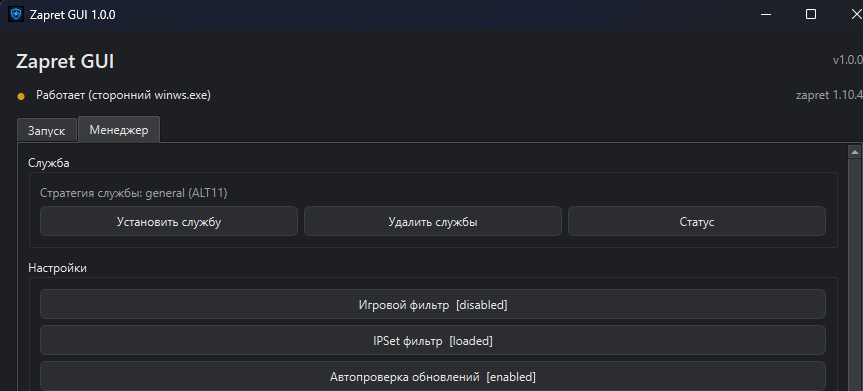

# Zapret GUI

Графическая оболочка (Windows, PySide6/Qt) для консольного
[zapret-discord-youtube](https://github.com/Flowseal/zapret-discord-youtube) от Flowseal.
Оборачивает `winws.exe` и полностью повторяет меню `service.bat`, добавляя
живой лог, тесты стратегий без внешних окон и автоматические обновления.



## Возможности

- **Вкладка «Менеджер» (стартовая)** — весь функционал `service.bat`:
  - Служба: установка (с выбором стратегии), удаление, статус;
  - Настройки: игровой фильтр (режим + диапазоны TCP/UDP), IPSet-фильтр
    (`loaded / none / any`), автопроверка обновлений, замена активных фейков;
  - Обновления: список IPSet, файл hosts, проверка обновлений zapret;
  - Инструменты: диагностика (с удалением конфликтующих служб и очисткой
    кэша Discord), тесты стратегий.
- **Вкладка «Запуск»** — выбор стратегии (`general*.bat`), Старт/Стоп,
  живой лог `winws.exe` в окне приложения.
- **Тесты без внешних окон**: стратегии запускаются скрыто, цели проверяются
  по HTTP/TLS 1.2/TLS 1.3 и ping; результат — встроенная таблица статистики
  (OK / ERR / SSL / UNSUP / Ping OK / Ping Fail) с подсветкой лучшей стратегии.
  Ранее работавший обход восстанавливается после тестов. Если служба zapret
  запущена, перед тестами предлагается отменить их или удалить службу и
  продолжить.
- **Первый запуск без zapret**: если папка не найдена на ПК, приложение
  предлагает скачать последний релиз Flowseal и распаковать его в папку
  проекта рядом с приложением (`zapret-discord-youtube-<версия>`); дальнейшие
  обновления ставятся в соседние папки с переносом ваших данных.
- **Обновления zapret** — как в оригинале: версия берётся из
  `.service/version.txt` main-ветки репозитория Flowseal; автопроверка
  уважает флаг `utils/check_updates.enabled`. Установка переносит ваши
  списки, настройки и кастомные стратегии в новую папку.
- **Самообновление приложения** из релизов этого репозитория
  (`SkyGeneral1996/Zapret-GUI`): скачивает новый `.exe`, заменяет себя и
  перезапускается.
- Трей, сворачивание в трей при закрытии, единственный экземпляр,
  запрос прав администратора (UAC) при запуске.

## Требования

- Windows 10/11 x64, права администратора (WinDivert требует elevation).
- Папка zapret (например `zapret-discord-youtube-1.10.4`) рядом с `.exe`
  либо указанная в «Настройках».
- Для запуска из исходников: Python 3.10+ и `pip install -r requirements.txt`.

## Быстрый старт

1. Скачайте `ZapretGUI.exe` из [Releases](../../releases) и положите рядом
   с папкой zapret (или укажите путь в «Настройках»). Если папки zapret нет,
   приложение при старте само предложит скачать её с GitHub автора.
2. Запустите — откроется вкладка «Менеджер».
3. «Запуск» → выберите стратегию → «Старт». Лог виден в той же вкладке.
4. Для постоянной работы: «Менеджер» → «Установить службу» → выберите
   стратегию в диалоге → служба стартует вместе с Windows.

## Сборка из исходников

```bat
pip install -r requirements.txt
build.bat
```

или вручную:

```bat
python -m PyInstaller ZapretGUI.spec --noconfirm
```

Готовый файл: `dist/ZapretGUI.exe` (onefile, без консоли, с UAC-манифестом).

## Как устроены обновления

### Приложение (этот репозиторий)

- Проверка: кнопка **«Проверить обновления ПО»** внизу окна и автопроверка
  при старте (если включена в настройках).
- Источник: GitHub Releases `SkyGeneral1996/Zapret-GUI`; обновление
  предлагается, если тег релиза новее `APP_VERSION` (`version.py`) и к
  релизу приложен `.exe`.
- Установка: новый exe скачивается рядом, скрытый скрипт ждёт завершения
  процесса, заменяет файл и перезапускает приложение.

### zapret (репозиторий автора)

- Проверка: «Менеджер» → «Проверить обновления zapret» (аналог пункта 10
  меню `service.bat`) и автопроверка при старте, если включён флаг
  `utils/check_updates.enabled`.
- Источник: `https://raw.githubusercontent.com/Flowseal/zapret-discord-youtube/main/.service/version.txt`
  сравнивается с `LOCAL_VERSION` из `service.bat` вашей папки.
- Если релиз с `.zip` уже опубликован — предлагается установка в один клик:
  обход останавливается, архив распаковывается в **соседнюю** папку,
  переносятся `lists/*-user.txt`, `ipset-all.txt`, `utils/game_filter.enabled`,
  `check_updates.enabled`, `targets.txt` и ваши кастомные `*.bat`; конфиг
  переключается на новую папку, стратегия перезапускается. Старая папка
  сохраняется для отката.
- Если версия в main уже новая, а релиз ещё не вышел — показывается
  уведомление и кнопка «Страница релиза» (как оригинал открывает страницу
  загрузки).

## Релизы

Версия приложения задаётся в `version.py` (`APP_VERSION`).

**Вариант 1 — вручную через веб-интерфейс GitHub:**

1. Поднимите `APP_VERSION`, пересоберите `dist/ZapretGUI.exe`, закоммитьте.
2. В репозитории: *Releases → Draft a new release*.
3. Tag: `v1.1.0` (create new tag on publish), заголовок и описание изменений.
4. Приложите `ZapretGUI.exe` в поле assets → *Publish release*.

**Вариант 2 — автоматически по тегу (CI):**

```bat
git tag v1.2.0
git push origin v1.2.0
```

Workflow `.github/workflows/release.yml` соберёт exe на `windows-latest`
и создаст релиз с приложенным файлом.

Порядок для истории версий: сначала релиз `v1.0.0` (предыдущая сборка),
затем `v1.1.0` с новыми изменениями — каждый релиз указывает на свой коммит.

## Структура проекта

```
app/
├── main.py               # вход: тема, UAC, единственный экземпляр
├── config.py             # конфиг %APPDATA%/ZapretGUI/config.json
├── version.py            # APP_VERSION, репозитории обновлений
├── core/
│   ├── zapret.py         # парсинг bat-стратегий, WinwsRunner, фильтры
│   ├── service.py        # служба, ipset, hosts, фейки, диагностика
│   ├── tests.py          # скрытые тесты стратегий + статистика
│   ├── github.py         # Releases API, скачивание с прогрессом
│   ├── updater.py        # обновление zapret и самообновление exe
│   └── admin.py          # проверка/запрос прав администратора
├── ui/
│   ├── main_window.py    # вкладки, баннер обновлений, трей
│   ├── manager_tab.py    # меню service.bat + таблица результатов тестов
│   ├── workers.py        # QThread-воркеры проверок/установок/тестов
│   └── settings_dialog.py
├── resources/            # иконки
├── docs/                 # скриншот
└── ZapretGUI.spec        # PyInstaller onefile + uac_admin
```

## Примечания

- Тесты и обновление zapret временно останавливают работающий обход и
  восстанавливают его после завершения; не запускайте их во время важной сессии.
- Вывод консоли Windows читается с учётом кодовой страницы cp866.
- Это неофициальная оболочка; все протоколы и списки — заслуга автора
  [Flowseal/zapret-discord-youtube](https://github.com/Flowseal/zapret-discord-youtube).

## Лицензия

MIT — см. [LICENSE](LICENSE).